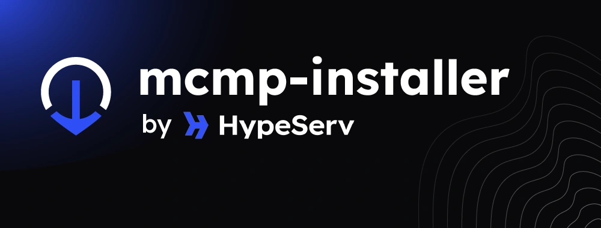

> This is being used at [HypeServ](https://hypeserv.com).

A TypeScript/Node.js installer that pulls a Minecraft modpack from a URL or provider, unpacks it, installs the right loader (Forge / NeoForge / Fabric), and leaves the server ready to start.

Installs **CurseForge** and **Modrinth** packs by project id, any serverpack from a **direct URL**, and the **serverpack-creator** output format (manifest.json / variables.txt).

CurseForge and Modrinth packs are resolved through [modpack-magic](https://github.com/hypeserv/modpack-magic): it picks the newest *release* (or the version you pin), prefers the server pack, and returns the download URL.

## Quick start (npx)

No install required — run the latest published version directly:

```bash
npx -y @hypeserv/mcmp-installer --provider modrinth --modpack-id <slug>
npx -y @hypeserv/mcmp-installer --provider curseforge --modpack-id 925200
npx -y @hypeserv/mcmp-installer --provider ftb --modpack-id 126
```

Direct zip URL:

```bash
npx -y @hypeserv/mcmp-installer --wget-mode --modpack-id https://example.com/pack.zip
```

Pin a specific version (recommended in Dockerfiles):

```bash
npx -y @hypeserv/mcmp-installer@1.5.0 --provider curseforge --modpack-id 925200 --modpack-version 6012345
```

## Global install

```bash
npm install -g @hypeserv/mcmp-installer
mcmp-installer --provider modrinth --modpack-id <slug>
```

## Usage

```bash
mcmp-installer --provider <provider> --modpack-id <id> [flags]
# or for a direct serverpack zip URL
mcmp-installer --wget-mode --modpack-id https://example.com/pack.zip
```

## Flags
| flag | description |
|---|---|
| `--provider` | `curseforge` (alias `curse`) \| `modrinth` \| `ftb` (alias `feed-the-beast`) \| `direct`. Required unless `--wget-mode`. `technic` is not supported yet: use `--wget-mode` with a serverpack URL. |
| `--modpack-id` | CurseForge project id, Modrinth slug/id, FTB pack id, or a URL for `direct`. In `--wget-mode` this is a direct zip URL. |
| `--modpack-version` | CurseForge file id / Modrinth version id / FTB version id to install. Latest release if omitted. Not used for `direct`. |
| `--resolver-url <url>` | modpack-magic base URL. Falls back to `MODPACK_MAGIC_URL`, then `https://modpack-magic.hypeserv.com`. |
| `--wget-mode` | Skip provider parsing — treat `--modpack-id` as a direct zip URL (HEAD redirect resolved). |
| `--wings` | Flatten install into the working dir instead of a modpack subfolder. Use with panel daemons (e.g. [Pterodactyl Wings](https://github.com/pterodactyl/wings)). |
| `--resolver-token <token>` | Bearer token for modpack-magic, sent as `Authorization: Bearer <token>` on the resolve call and the CurseForge file lookup. Falls back to `MODPACK_MAGIC_TOKEN`. Required for CurseForge client packs and FTB files hosted on CurseForge, in both the provider and `--wget-mode` flows; without it those installs fail. Prefer the env var: command-line args show up in the process list. The token is never logged. |
| `--preserve-world` | With `--wings`: keep world dirs (`level-name`, `_nether`, `_the_end`, `world*`) and `server.properties` already in the working dir; the pack's copies are dropped. Use for reinstalls/updates that keep the world. |
| `--working-path <dir>` | Directory to install into. Defaults to CWD. |
| `--folder-name <name>` | Explicit output folder name (ignored in `--wings`). |
| `--clean-scripts` | Remove `.sh` / `.bat` startup scripts after install. |
| `--update` | Remove `/mods`, `/.fabric`, `/libraries`, `/coremods` before installing. |

## Install info

After a successful install the installer writes `.hypeserv/modpack.json` into the server root:

```json
{
  "provider": "curseforge",
  "projectId": "925200",
  "versionId": "6012345",
  "mcVersion": "1.21.1",
  "loader": "neoforge",
  "installedAt": "2026-11-03T14:00:00.000Z"
}
```

For `direct` / `--wget-mode` installs, `versionId` is `null` and `mcVersion` / `loader` come from the detected loader, if any.

Installs that download mods from a CurseForge `manifest.json` also add a `mods` object:

```json
"mods": {
  "source": "manifest",
  "total": 425,
  "installed": 318,
  "restricted": [{ "projectId": 563734, "fileId": 3857874, "fileName": "BuildersDelight-1.18.2-v.1.0.jar", "installed": true }],
  "failed": [],
  "clientOnlyRemoved": ["LegendaryTooltips-1.18.2-1.3.1.jar"],
  "skipped": [{ "projectId": 1, "fileId": 2, "fileName": "Complementary.zip", "type": "shader" }],
  "datapacks": ["structures.zip"]
}
```

`restricted` lists mods whose authors disabled third-party distribution. `failed` lists mods that could not be installed, with a `reason`. `clientOnlyRemoved` lists client-only mods that were removed because they would crash a dedicated server. `skipped` lists files not installed on purpose (resourcepacks, shaders, other content, optional files that no longer exist). `datapacks` lists datapacks placed in `<level-name>/datapacks/`.

## What it handles
- Standard CurseForge serverpacks (with/without bundled loader; packs without a loader get one from a shipped installer jar or inferred from the mods)
- CurseForge client packs without a server pack: all files looked up in one modpack-magic batch call before any download, mods into `mods/`, datapacks into `<level-name>/datapacks/`, resourcepacks and shaders skipped, sha1 checked, plus `overrides/`. The install fails (non-zero exit) when the token is missing, the lookup fails, a required file no longer exists, or `mods/` ends up empty.
- FTB packs (numeric pack / version ids): files from the FTB version manifest with size + sha1 check, client-only files skipped, exact loader version from the manifest
- Modrinth `.mrpack` (files at their index paths, client-only files skipped, overrides + dependencies)
- packwiz bootstrap server packs (runs packwiz-installer at install time)
- Client-only mods removed on manifest installs (jar metadata + a curated list; kept when another mod requires them)
- Start target for panels: `unix_args.txt`, or a `server.jar` that launches the loader (Fabric launcher / Forge jar), never plain vanilla
- Downloads retry and resume; progress is printed as plain lines when the output is not a terminal
- serverpack-creator output (manifest.json **or** variables.txt)
- Nested folder zips (auto-flattens one level)
- Forge / NeoForge / Fabric installer download + run via Java
- Copies `unix_args.txt` / `win_args.txt` + loader server jars to modpack root so start scripts always find them

## Requirements
- Node.js 18+ (and npm)
- Java 11+ (for Forge / NeoForge / Fabric server installers)


## License

Source-available. See [LICENSE](./LICENSE) for terms — read/run permitted, redistribution and derivative works require written permission.

---
&copy; onesrv — HypeServ
